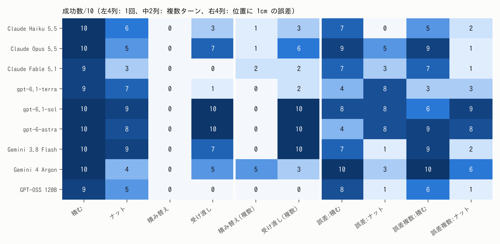

# LLM にロボット制御コードを書かせて比べる（CaP-X）

PAI 応用編1 の最終課題。Code-as-Policy のベンチマーク **CaP-X**（robosuite のシミュレータ）で、
9 個の LLM にロボットを動かす Python コードを書かせ、成功率を比べた。
GENIAC-PRIZE 2026（Code-as-Policy）の下準備も兼ねている。

- 4つのタスク: 積む・ナット・積み替え・受け渡し（両腕）
- 4つの条件: 1回で答える／実行結果を見て書き直せる「複数ターン」／位置に 1cm の誤差（画像認識の誤差の代わり）／誤差＋複数ターン
- 各セル10回、合計 900 試行。物体の位置はシミュレータの真の値を使う「特権情報あり」の設定のみ。
- 案A: 小さいオープンモデル（Qwen3.5-9B、Colab の A100）に、①実行結果を見て書き直す ②大きいモデルの成功コードを見本に足す、を加えて3タスク×4条件×10回（120 試行）。

レポートの下書きは [`report/report_draft.md`](report/report_draft.md)、図は [`report/figs/`](report/figs/)、表は [`report/tables/`](report/tables/)。

## 結果の要約

<!-- results:start（scripts/make_report.py が書き換える。手で直さない） -->
成功数/10（9モデル×10セル、effort はすべて medium）

| モデル | 積む | ナット | 積み替え | 受け渡し | 積み替え(複数) | 受け渡し(複数) | 誤差:積む | 誤差:ナット | 誤差複数:積む | 誤差複数:ナット | 合計/100 |
|---|---|---|---|---|---|---|---|---|---|---|---|
| Claude Haiku 5.5 | 10 | 6 | 0 | 3 | 1 | 3 | 7 | 0 | 5 | 2 | 37 |
| Claude Opus 5.5 | 10 | 5 | 0 | 7 | 1 | 6 | 9 | 5 | 9 | 1 | 53 |
| Claude Fable 5.1 | 9 | 3 | 0 | 0 | 2 | 2 | 7 | 3 | 7 | 1 | 34 |
| gpt-6.1-terra | 9 | 7 | 0 | 1 | 0 | 2 | 4 | 8 | 3 | 3 | 37 |
| gpt-6.1-sol | 10 | 9 | 0 | 10 | 0 | 10 | 8 | 8 | 6 | 9 | 70 |
| gpt-6-astra | 10 | 8 | 0 | 10 | 0 | 10 | 4 | 8 | 9 | 8 | 67 |
| Gemini 3.8 Flash | 10 | 9 | 0 | 7 | 0 | 10 | 7 | 1 | 9 | 2 | 55 |
| Gemini 4 Argon | 10 | 4 | 0 | 5 | 5 | 3 | 10 | 3 | 10 | 6 | 56 |
| GPT-OSS 120B | 9 | 5 | 0 | 0 | 0 | 0 | 8 | 1 | 6 | 1 | 30 |

Claude Fable 5.1 の複数ターン4セル（積み替え(複数)・受け渡し(複数)・誤差複数）はクラウドの Linux、ほかは手元の Mac で回した。

合計の順位: gpt-6.1-sol（70）、gpt-6-astra（67）、Gemini 4 Argon（56）、Gemini 3.8 Flash（55）、Claude Opus 5.5（53）、Claude Haiku 5.5（37）、gpt-6.1-terra（37）、Claude Fable 5.1（34）、GPT-OSS 120B（30）。



- **積む**はほぼ全モデルが満点（9モデル合計 87/90）。差が出るのは**受け渡し**（両腕の協調）と**ナット**（向きを合わせる）。
- **受け渡し**は gpt-6.1-sol・gpt-6-astra が 10/10・10/10、gpt-6.1-terra・Claude Fable 5.1・GPT-OSS 120B が 1/10・0/10・0/10（Fisher の正確検定で p≤0.0001）。
- **積み替え**（最初から緑が赤の上に載っている）は、1回で答えると全モデル 0/10。複数ターンにすると Gemini 4 Argon だけが 5/10 になり（p=0.033、多重比較の補正後は言い切れない）、成功はすべて実行結果を見て書き直した試行だった。書き直さずに「完了」と答えるモデルには、複数ターンが効かない。
- **位置に 1cm の誤差**を足すと、9モデル合計でナットが 56/90→37/90（p=0.007）に下がった。大きく下がったのは Gemini 3.8 Flash（9/10→1/10）と Claude Haiku 5.5（6/10→0/10）。ただし誤差ありのセルは、回し直すと1セルで最大 5 回ぶれるので、10回での細かい差は言い切れない。
- **案A**（小さいオープンモデル Qwen3.5-9B、Colab の A100）: そのままでは積む・ナット・受け渡しが 1/10・0/10・0/10。①実行結果を見て書き直す、②大きいモデルの成功コード（ほかのタスクの分）を見本に足す、を入れると積むは 5/10・5/10・6/10（①・②・①＋②）に上がった。1つずつでは 10回では言い切れない（p≥0.057）が、3条件まとめると 16/30 対 1/10（p=0.026）で、何かを足すと上がることはほぼ言える。①と②のどちらが効いたかは区別できない。ナットと受け渡しはほぼ 0 のまま。①で成功した試行も、3/5 は書き直さずに最初のコードで成功していた。

<!-- results:end -->

数字はすべて `results/` の CSV から `scripts/make_report.py` で計算している（詳しくはレポートの4〜5章）。

## ディレクトリ構成

| 場所 | 中身 |
|---|---|
| `report/` | レポートの下書き（`report_template.md` → `report_draft.md`）、図（`figs/`）、表（`tables/`） |
| `results/` | 集計した CSV と表。`all_summary.md` が全モデルの一覧（正式な値の出どころもここに書いてある） |
| `scripts/` | 実験と集計のスクリプト（下の表） |
| `proxy/cli_proxy.py` | CLI（Claude Code・Codex・Antigravity）を OpenAI 互換の API に見せる中継サーバー |
| `pai_ext/` | CaP-X の拡張。位置に誤差を足す API（`*_Noisy`）と、掴み方の補助を外す API（`*_NoGrasp`） |
| `patches/` | CaP-X への変更（`capx.patch`）と、もとにした commit（`CAPX_COMMIT`） |
| `configs/` | 条件ごとの CaP-X の設定（`scripts/make_configs.py` で生成） |
| `cloud_runs/` | クラウドの Linux で回した Fable の複数ターン4セル（コード・動画・記録）と、その環境のメモ `ENV.md` |
| `replay/` | Fable の1回で答える条件の回答（クラウドで作り、手元で再生した） |
| `skill_src/` | 誤差なしの条件で成功したコード（小さいモデルに手本として渡す「スキルライブラリ」の材料） |
| `skill_lib/` | 案A で実際に渡した見本（タスクごと。同じタスクの成功コードは入れない）と選び方（`README.md`） |
| `colab/` | 案A を Colab で回すノートブック（`pai_planA.ipynb`）と手順（`README.md`） |
| `runs/planA/ENV_planA.md` | 案A を回した Colab の環境と、回して分かった注意点 |
| `NOTES.md` | 作業の経緯と細かい発見 |

| スクリプト | 役目 |
|---|---|
| `make_configs.py` | 公式の設定から、条件ごとの設定を `configs/` に作る |
| `run_grid.py` | モデル×タスク×条件を順に回す（IK サーバーの見張りと立て直しもする） |
| `run_main.sh` / `run_clean.sh` | 本番（7モデル）と、Codex の回し直し（個人設定を除いた状態） |
| `gen_replay.py` | 手元で呼べないモデルの回答を先に作っておく（`replay/`） |
| `analyze.py` | `runs/` を集計して `results/<tag>_*` を作る |
| `scan_averaging.py` | 誤差ありの条件で、位置を何度も読んで平均するコードかを数える（正規表現による目安） |
| `export_skill_src.py` | 成功したコードを `skill_src/` に書き出す |
| `select_skills.py` | `skill_src/` から案A の見本を選び、`skill_lib/` に書き出す |
| `check_skill_prompts.py` | 見本を除くと、見本ありのプロンプトが見本なしと1文字も違わないことを確かめる |
| `make_report.py` | レポートの表・検定・図を作り、下書きに数字を差し込む |
| `make_video.py` | 提出用の短い動画（字幕のみ）を `runs/` の試行動画からつなぐ（ffmpeg と Pillow が要る） |

実験の生データ（`runs/`、試行ごとのコードと動画）は大きいのでリポジトリに入れていない（案A の環境メモ `runs/planA/ENV_planA.md` だけは入れている）。集計は `results/` にある。

## 動かし方

### 必要なもの
- CaP-X: github.com/capgym/cap-x の commit `53e9966`（`patches/CAPX_COMMIT`）。このリポジトリの隣の `../third_party/cap-x` に置く。
- Python 3.12。mujoco 3.5.0、numpy 1.26.4、scipy 1.14 系（Mac では `scipy<1.15` に固定）。版の一覧は `cloud_runs/ENV.md`。
- LLM を呼ぶ CLI（Claude Code・Codex・Antigravity のどれか）と、そのサブスクリプション。

### CaP-X の準備
```bash
git clone https://github.com/capgym/cap-x ../third_party/cap-x
```
```bash
cd ../third_party/cap-x && git checkout 53e9966 && git submodule update --init && git apply ../../pai-final-cap/patches/capx.patch
```
CaP-X の venv に、このリポジトリのルートを通す（`pai_ext` を import するため。site-packages に `.pth` を置くなど）。
そのあと、このリポジトリで設定を作る。
```bash
python3 scripts/make_configs.py
```

### Mac
```bash
../third_party/cap-x/.venv-mac/bin/python proxy/cli_proxy.py --port 8120
```
別の端末で、1回だけ試す（cap-x のフォルダで）:
```bash
MUJOCO_GL=cgl CAPX_LLM_TIMEOUT=600 .venv-mac/bin/python capx/envs/launch.py \
  --config-path env_configs/cube_lifting/franka_robosuite_cube_lifting_privileged.yaml \
  --model claude-cli/claude-sonnet-5-5 --server-url http://127.0.0.1:8120/chat/completions \
  --total-trials 1 --num-workers 1 --record-video True --output-dir /tmp/capx_try
```
本番と同じ組み合わせを回す（途中で止まっても同じコマンドで続きから）:
```bash
./scripts/run_main.sh
```
macOS では IK サーバー（PyRoKi）が並行処理で固まることがある。`run_grid.py` が応答を確かめ、立て直してやり直す。

### Linux（GPU なし）
描画を OSMesa にする以外は Mac と同じ（詳しくは `cloud_runs/ENV.md`）。
```bash
sudo apt-get install -y libosmesa6 libegl1 libgl1
```
```bash
export MUJOCO_GL=osmesa PYOPENGL_PLATFORM=osmesa CAPX_DIR=../third_party/cap-x CAPX_PYTHON=../third_party/cap-x/.venv/bin/python
```
```bash
python3 scripts/run_grid.py --tag try --models claude-cli/claude-haiku-5-5@medium --tasks stack --conds base --trials 1 --workers 1
```
`run_main.sh`・`run_clean.sh` は zsh と Mac の venv の場所を前提にしているので、Linux では `run_grid.py` を直接呼ぶ。

### Colab（案A、GPU）
`colab/pai_planA.ipynb` を上から順に実行する。vLLM で Qwen3.5-9B を OpenAI 互換のサーバーとして立て、同じランタイムで CaP-X を回す。
GPU の選び方や、回して分かった注意点（vLLM の長さの上限、止まった試行の見張りなど）は `colab/README.md` と `runs/planA/ENV_planA.md`。

### 集計とレポート
```bash
python3 scripts/analyze.py --tag main --since <開始の UNIX 時刻>
```
```bash
pip install matplotlib && python3 scripts/make_report.py
```
`make_report.py` は `results/` と `cloud_runs/cloud/summary.csv` だけを読む（`runs/` があれば、平均化の集計も全モデル分になる）。
PDF は `uv run --with markdown python report/build_pdf.py <出力先.pdf>`（Google Chrome のヘッドレス印刷）。

## CaP-X への変更（`patches/capx.patch`）

| ファイル | 変更 |
|---|---|
| `capx/llm/client.py` | LLM の待ち時間を環境変数 `CAPX_LLM_TIMEOUT` で変えられるようにした（既定 200 秒のまま） |
| `capx/integrations/motion/pyroki.py` | IK サーバーの待ち時間を `CAPX_IK_TIMEOUT` で変えられるようにした（既定 15 秒のまま） |
| `capx/envs/trial.py` | 動画を最初の N 試行だけにする（`CAPX_VIDEO_TRIALS`、既定 0 = 全部） |
| `capx/integrations/__init__.py` | 最後に `pai_ext` を import する（無ければ何もしない）。誤差あり・掴み方の補助なしの API が登録される |

環境変数を設定しなければ、CaP-X の元の動きは変わらない。

## 中継サーバー（`proxy/cli_proxy.py`）の注意

- **自分の CLI のログイン（サブスクリプション）で LLM を呼ぶ。** 呼ぶたびに自分の利用枠を使う。
  自動で大量に呼ぶ使い方が各サービスの利用規約で認められているか、使う前に自分で確かめること。
- **外に公開しない。** `127.0.0.1` だけで待ち受ける。認証は無いので、ポートを外に開けると他人があなたの枠で LLM を呼べてしまう。
- **ツールは切ってあるが、CLI は手元で動く。** Claude は `--tools ""`、Codex は読み取り専用のサンドボックスと空の作業フォルダ、
  Antigravity は `--sandbox`。それでも CLI 自体はあなたの権限で動くプロセスである。
- **Codex は既定で専用の設定フォルダ（`~/.cache/pai-final/codex-home`）を使う。** 認証ファイルへのリンクだけを置き、
  個人ルール（`~/.codex/AGENTS.md`）・メモリ・プラグインなどが文脈に入らないようにしている。
  `--codex-home user` にすると `~/.codex` のまま（個人設定が入る）になり、結果は比べられなくなる。
- **記録** `logs/proxy_calls.jsonl` には、所要時間・文字数・トークン数・エラーが残る（プロンプトの本文は残さない）。`logs/` は git に入れない。
- モデル名の書き方: `claude-cli/<model>@<effort>`、`codex-cli/<model>@<effort>`、`agy-cli/<model>`、`replay-cli/<name>`。

## ライセンスと出典

- このリポジトリのコード（`scripts/`・`proxy/`・`pai_ext/` など）: MIT ライセンス（`LICENSE`）
- `patches/capx.patch` は CaP-X への差分で、CaP-X のライセンスに従う。
- CaP-X: https://github.com/capgym/cap-x （使い方と引用は CaP-X のリポジトリに従う）
- robosuite（ARISE Initiative）、MuJoCo（Google DeepMind）、PyRoKi
- 使ったモデル: Claude（Anthropic）、GPT・Codex（OpenAI）、Gemini（Google）、GPT-OSS（OpenAI のオープンモデル）。
  `skill_src/`・`replay/`・`cloud_runs/` のコードは、これらのモデルが生成したもの。
