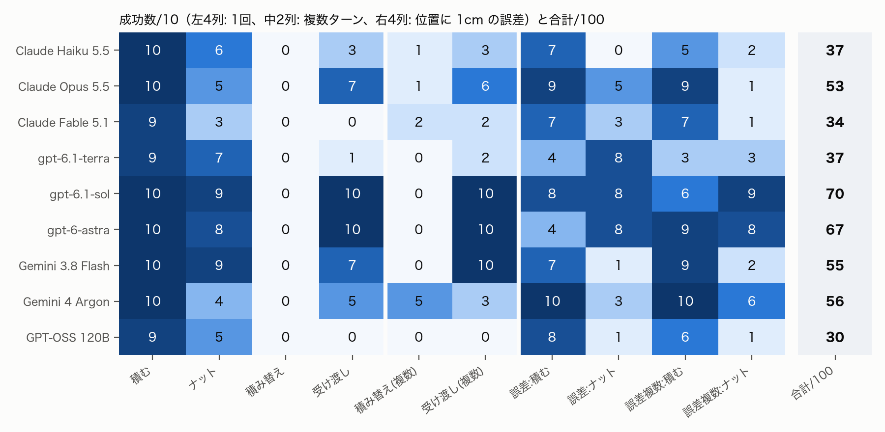
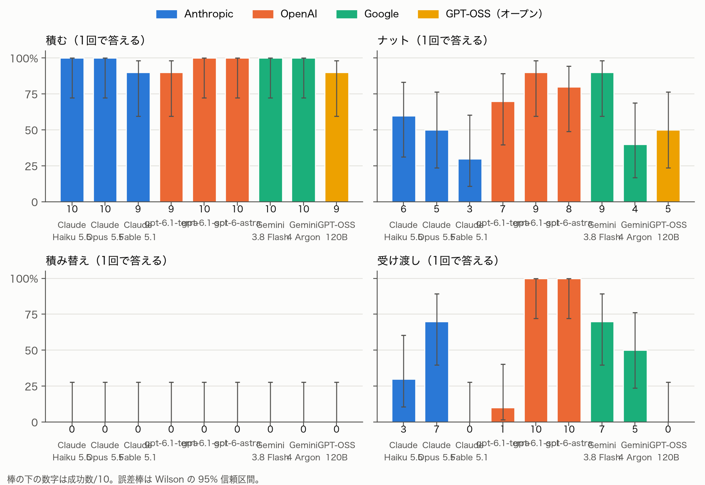
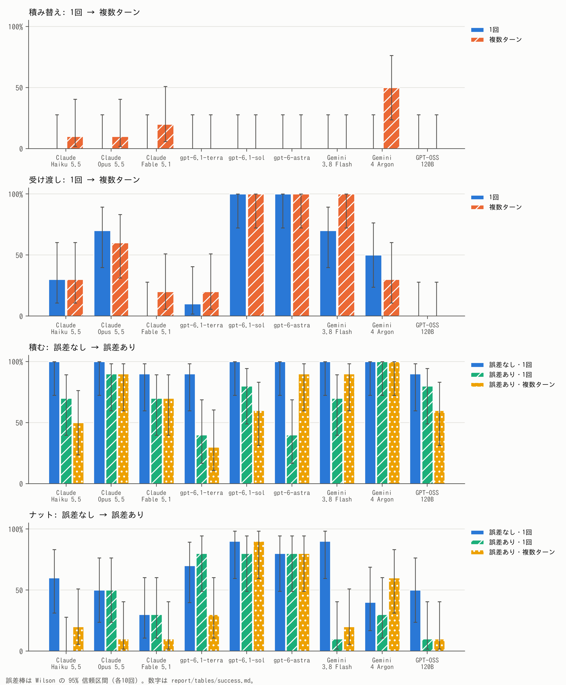
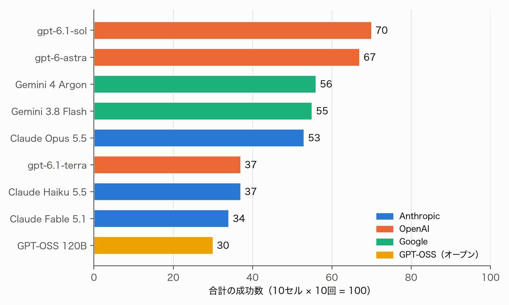
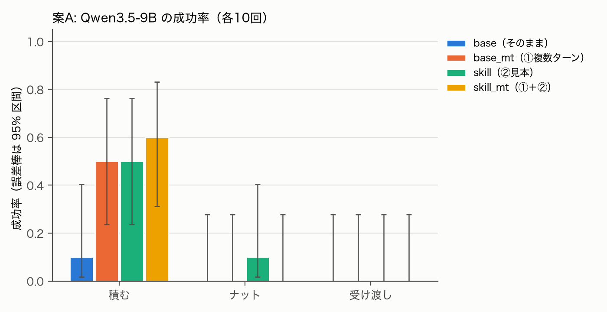

<!-- このファイルは scripts/make_report.py が report/report_template.md から作る。直すときはテンプレートの方を直す。 -->
# LLM にロボット制御コードを書かせる — CaP-X での 9 モデルの比較と、小型オープンモデルの底上げ

PAI 応用編1 最終課題 レポート

コード・設定・結果: github.com/Shinzo0821/pai-final-cap
（このレポートの数字は、すべて `scripts/make_report.py` が `results/` と `cloud_runs/` の CSV から計算して差し込んだもの。表と図は `report/tables/` と `report/figs/` にある）

### 要旨

Code-as-Policy（LLM にロボットを動かすプログラムを書かせるやり方）のベンチマーク CaP-X で、2つの実験を行った。

**実験1: 大規模 LLM 9 モデルの比較**（3〜5章）。4 タスク・10 セル・各 10 回（900 試行）で成功率を比べた。条件は「1回で答える（シングルターン）」「実行結果を見せて書き直させる（複数ターン）」「物体の位置に標準偏差 1cm の誤差を足す」。

- **差が出るのは両腕の受け渡し。** gpt-6.1-sol・gpt-6-astra は 10/10、gpt-6.1-terra・Fable・GPT-OSS は 0〜1/10（p≤0.0001）。キューブを積むだけなら、ほぼ全モデルが満点。
- **複数ターンは、モデルが自分で確かめて直すときだけ効く。** 積み替えは1回で答えると全モデル 0/10。複数ターンで上がったのは Gemini 4 Argon（5/10）だけで、その成功はすべて書き直した試行だった。
- **位置の誤差には弱い。** 1cm の誤差で、9モデル合計のナットは 56/90→37/90 に下がった。位置を何度も読んで平均するコードを書くのは、Opus と Argon など一部のモデルだけだった。

**実験2: 小型オープンモデルの底上げ**（6章）。小型のオープンモデル Qwen3.5-9B に、①複数ターンと、②大規模モデルの成功コードを見本としてプロンプトに足す「スキルライブラリ」を加え、3 タスク × 4 条件 × 各 10 回（120 試行）を Colab の GPU で回した。

- **大規模モデルには大きく届かない。** そのままでは積む 1/10。①②を足すと積むは 5〜6/10 に上がったが、ナットと受け渡しはほぼ 0 のままだった。
- ①はコードが例外で止まるのを減らした（16/30→2/30）が、ナットと受け渡しでは止まらなくなっても成功に届かなかった。②では、見本にしかない関数を写して止まる副作用があった。

---

## 1. 目的と全体像

GENIAC-PRIZE 2026 の本コンテスト（Code-as-Policy）の下準備として、
「LLM にロボットを動かすプログラムを書かせると、どのモデルが、どんな作業で、どこまでできるか」と、
「小さいモデルでも、仕組みを足せばどこまで近づけるか」を確かめる。

**Code-as-Policy** は、LLM が直接ロボットの関節を動かすのではなく、
「物体の位置を調べる」「掴む位置を決める」「手先をそこへ動かす」といった関数（API）を組み合わせた
Python のプログラムを書き、それを実行してロボットを動かすやり方である。
モデルの選び方や、間違えたときに直させる仕組み（複数ターン）、
認識の誤差にどう備えるかは、本コンテストでもそのまま効いてくる。

この課題は、目的の違う2つの実験からなる。

| | 実験1: 大規模 LLM の比較 | 実験2: 小型オープンモデルの底上げ |
|---|---|---|
| 問い | 大規模 LLM 9 モデルで、成功率はどれくらい違うか。複数ターンと位置の誤差で、どう変わるか | 小型モデルに ①複数ターン ②スキルライブラリ を足すと、どこまで上がるか |
| モデル | Claude・GPT・Gemini・GPT-OSS の計 9 モデル（CLI 経由。内訳は 3.1 節） | Qwen3.5-9B（Colab の A100 で vLLM） |
| タスク | 積む・ナット・積み替え・受け渡し | 積む・ナット・受け渡し |
| 条件 | 1回で答える／複数ターン／位置の誤差／誤差＋複数ターン | そのまま／①／②／①＋② |
| 試行 | 9 モデル × 10 セル × 各10回 = 900 | 3 タスク × 4 条件 × 各10回 = 120 |
| 章 | 3〜5章 | 6章 |

実験1では次の3つを調べた。

1. 大規模 LLM 9 モデルで、同じ作業の成功率はどれくらい違うか。
2. 実行結果を見て書き直せる「複数ターン」にすると、成功率は上がるか。
3. 物体の位置に誤差（画像認識の誤差の代わり）を入れると、どれくらい下がるか。誤差に備えたコードを書くモデルはあるか。

実験2は、実験1の結果（大規模モデルの成功コードと、複数ターンの効き方）を材料にしている。

## 2. CaP-X と使ったタスク

**CaP-X** は Code-as-Policy のベンチマークで、ロボットのシミュレータ robosuite（MuJoCo）の上で動く。
LLM には、作業の説明と使える関数の説明（API）がプロンプトとして渡される。
LLM が返した Python のコードをそのまま実行し、終わった時点で作業ができていれば成功とする。

今回はすべて**特権情報あり**の設定を使った。物体の位置はシミュレータの真の値がそのまま返る
（`get_object_pose` など）。掴む位置と向きを返す関数（`sample_grasp_pose`）もある。
画像認識の設定は GPU（SAM3 など）が要るため、手元の Mac では動かせなかった。

使ったタスクは4つ。予備実験（各3回）で、拭く（spill_wipe）は軽いモデルでも満点だったので外し、
両腕で持ち上げる（two_arm_lift）は正解コードでも 1/3 しか成功しなかったので外した。

| タスク | 中身 | 難しいところ |
|---|---|---|
| 積む（cube_stack） | 赤いキューブを緑の上に積む | ほぼなし（基本の確認） |
| ナット（nut_assembly） | 四角いナットを柱に通す | ナットの向きを柱に合わせる |
| 積み替え（cube_restack） | 積み方を入れ替える | 最初から緑が赤の上に載っている。まず下ろす必要がある |
| 受け渡し（two_arm_handover） | 片腕で持った物をもう片方の腕に渡す | 2本の腕の位置と向きの協調 |

正解コード（人が書いた特権情報ありのコード）は、この4タスクで各3回とも成功する
（Mac・クラウドの Linux の両方で確認）。つまり失敗は、シミュレータではなく LLM のコードの問題である。

## 3. 実験1の条件

### 3.1 モデルと回数

| 会社 | モデル | 呼び方 |
|---|---|---|
| Anthropic | Claude Haiku 5.5、Claude Opus 5.5、Claude Fable 5.1 | Claude Code CLI |
| OpenAI | gpt-6.1-terra、gpt-6.1-sol、gpt-6-astra | Codex CLI |
| Google | Gemini 3.8 Flash、Gemini 4 Argon | Antigravity CLI |
| オープン | GPT-OSS 120B | Antigravity CLI |

推論の深さ（effort）はすべて medium。1つの組み合わせ（モデル×タスク×条件、以下「セル」）を10回ずつ回した。
9モデル×10セル×10回 = 900 試行。

### 3.2 条件

| 条件 | 中身 | セル |
|---|---|---|
| 1回で答える（base） | CaP-X の公式設定のまま。LLM はコードを1回だけ書く | 4タスク |
| 複数ターン（base_mt） | 実行したコードと、その標準出力・エラーを LLM に見せ、「書き直す（REGENERATE）」か「完了（FINISH）」かを選ばせる。文面は CaP-X 公式の複数ターン用プロンプトと同じ | 積み替え・受け渡し |
| 誤差あり（noisy） | 位置を返す関数の戻り値に、呼ぶたびに独立な誤差（標準偏差 1cm のガウス分布）を足す | 積む・ナット |
| 誤差あり＋複数ターン（noisy_mt） | 上の2つを合わせたもの | 積む・ナット |

**位置の誤差について。** 実際のロボットでは、物体の位置はカメラの画像から推定するので、数 mm〜数 cm ずれる。
特権情報ありの設定ではこのずれが無いので、`get_object_pose`・`sample_grasp_pose` の位置に 1cm の誤差を足して、
画像認識の誤差の代わりにした（拡張 `pai_ext/`）。関数の説明文には
「位置は認識システムから来ており、約 1cm の誤差が呼ぶたびに独立に入る」と書き足した。
誤差は呼ぶたびに変わるので、**同じ位置を何回か読んで平均すれば小さくできる**。
正解コードで確かめると、誤差ありでは積む・積み替え・ナットが 0/5・0/5・0/5 だが、
30回読んで平均するように直すと（各5試行） 4/5・5/5・3/5 になった（表5）。

### 3.3 CLI の中継と、層の点検

LLM はすべて、サブスクリプションで使える CLI（Claude Code・Codex・Antigravity）から呼んだ。
CaP-X は OpenAI 互換の HTTP API で LLM を呼ぶので、CLI を API に見せかける中継サーバー（`proxy/cli_proxy.py`）を作った。
CLI にはツール（ファイル操作・コマンド実行・Web 検索）を使わせず、決めた短いシステムプロンプトだけを渡した。

CLI は、利用者の個人設定などを勝手に文脈へ足すことがある。そこで中継の層を点検した。

- **Codex は個人設定を読んでいた。** 個人ルール・メモリ・スキル一覧・プラグインなどが毎回入っていた
  （「OK とだけ答えて」で入力 23,299 トークン。数字は NOTES.md の記録）。
  認証ファイルだけを持つ専用の設定フォルダを使うように直し（7,918 トークン）、Codex の全セルを回し直した。
  **Codex の正式な値は、この回し直し（runs/clean）**とし、最初の値（runs/main）は点検の比較用に残した。
- **回答中のツールの使用は無かった。** Antigravity は全会話が「入力→回答」の2段だけ、Codex は本番のプロンプトを流し直してツール呼び出し0回。
- Claude は最初から個人設定を読まない引数（`--setting-sources ""` など）で呼んでいる。

Fable は手元から呼べないので、クラウドの Linux コンテナで回した。1回で答える条件は、クラウドで作った回答を手元で再生し
（中継の `replay-cli`）、複数ターンの4セルはクラウドの Linux（CPU 描画）でそのまま回した。

## 4. 実験1の結果

### 4.1 全体の表

表1 成功数/10（全9モデル×10セル）

| モデル | 積む | ナット | 積み替え | 受け渡し | 積み替え(複数) | 受け渡し(複数) | 誤差:積む | 誤差:ナット | 誤差複数:積む | 誤差複数:ナット | 合計/100 |
|---|---|---|---|---|---|---|---|---|---|---|---|
| Claude Haiku 5.5 | 10 | 6 | 0 | 3 | 1 | 3 | 7 | 0 | 5 | 2 | 37 |
| Claude Opus 5.5 | 10 | 5 | 0 | 7 | 1 | 6 | 9 | 5 | 9 | 1 | 53 |
| Claude Fable 5.1 | 9 | 3 | 0 | 0 | 2 | 2 | 7 | 3 | 7 | 1 | 34 |
| gpt-6.1-terra | 9 | 7 | 0 | 1 | 0 | 2 | 4 | 8 | 3 | 3 | 37 |
| gpt-6.1-sol | 10 | 9 | 0 | 10 | 0 | 10 | 8 | 8 | 6 | 9 | 70 |
| gpt-6-astra | 10 | 8 | 0 | 10 | 0 | 10 | 4 | 8 | 9 | 8 | 67 |
| Gemini 3.8 Flash | 10 | 9 | 0 | 7 | 0 | 10 | 7 | 1 | 9 | 2 | 55 |
| Gemini 4 Argon | 10 | 4 | 0 | 5 | 5 | 3 | 10 | 3 | 10 | 6 | 56 |
| GPT-OSS 120B | 9 | 5 | 0 | 0 | 0 | 0 | 8 | 1 | 6 | 1 | 30 |

95% 信頼区間（Wilson）つきの表は `report/tables/success.md`。

図0 全セルの成功数。色が濃いほど成功が多い。右端は10セルの合計（/100、表1の合計と同じ）。

### 4.2 タスク別（1回で答える条件）

図1 タスク別の成功率（1回で答える条件）。誤差棒は Wilson の 95% 信頼区間。

- **積む**は、ほぼ全モデルが満点（9モデル合計 87/90）。差は出ない。
- **ナット**は 5/10〜9/10 と散らばる。
- **積み替え**は、1回で答えると全モデル 0/10。
- **受け渡し**は差が最も大きい。gpt-6.1-sol と gpt-6-astra が 10/10・10/10、
  gpt-6.1-terra が 1/10、Fable と GPT-OSS が 0/10・0/10。

### 4.3 条件別

図2 条件別の成功率。上2段は1回と複数ターン、下2段は誤差なしと誤差あり。

### 4.4 合計

図3 10セルの合計（/100）。

順位は gpt-6.1-sol（70）、gpt-6-astra（67）、Gemini 4 Argon（56）、Gemini 3.8 Flash（55）、Claude Opus 5.5（53）、Claude Haiku 5.5（37）、gpt-6.1-terra（37）、Claude Fable 5.1（34）、GPT-OSS 120B（30）。
ただし合計は、セルごとの難しさの違う100試行を足したもので、近いモデルどうし（例: 55 と 56）の順位には意味が無い。

### 4.5 主な差の検定

2つの成功率の差が偶然かどうかを、Fisher の正確検定（両側）で調べた。
同じ種類の比較をまとめて何回も検定すると、偶然 p<0.05 になるものが出やすいので、まとまりごとに Holm の補正もかけた。

表2 主な検定

| 比べたもの | A | B | p（両側） | p（Holm 補正） |
|---|---|---|---|---|
| 1回の受け渡し: gpt-6.1-sol vs gpt-6.1-terra | 10/10 | 1/10 | 0.0001 | 0.0007 |
| 1回の受け渡し: gpt-6.1-sol vs Claude Fable 5.1 | 10/10 | 0/10 | <0.0001 | 0.0001 |
| 1回の受け渡し: gpt-6.1-sol vs GPT-OSS 120B | 10/10 | 0/10 | <0.0001 | 0.0001 |
| 1回の受け渡し: gpt-6-astra vs gpt-6.1-terra | 10/10 | 1/10 | 0.0001 | 0.0007 |
| 1回の受け渡し: gpt-6-astra vs Claude Fable 5.1 | 10/10 | 0/10 | <0.0001 | 0.0001 |
| 1回の受け渡し: gpt-6-astra vs GPT-OSS 120B | 10/10 | 0/10 | <0.0001 | 0.0001 |
| Gemini 3.8 Flash のナット: 誤差なし vs 誤差あり（1回） | 9/10 | 1/10 | 0.001 | 0.020 |
| Claude Haiku 5.5 のナット: 誤差なし vs 誤差あり（1回） | 6/10 | 0/10 | 0.011 | 0.184 |
| GPT-OSS 120B のナット: 誤差なし vs 誤差あり（1回） | 5/10 | 1/10 | 0.141 | 1.000 |
| 9モデル合算のナット: 誤差なし vs 誤差あり | 56/90 | 37/90 | 0.007 | 0.021 |
| 9モデル合算の積む: 誤差なし vs 誤差あり | 87/90 | 64/90 | <0.0001 | <0.0001 |
| Gemini 4 Argon の積み替え: 1回 vs 複数ターン | 0/10 | 5/10 | 0.033 | 0.585 |
| Gemini 3.8 Flash の受け渡し: 1回 vs 複数ターン | 7/10 | 10/10 | 0.211 | 1.000 |
| 9モデル合算のナット: 誤差あり 1回 vs 複数ターン | 37/90 | 33/90 | 0.647 | 1.000 |
| 9モデル合算の積む: 誤差あり 1回 vs 複数ターン | 64/90 | 64/90 | 1.000 | 1.000 |
| gpt-6.1-terra の誤差複数:ナット: main vs clean | 8/10 | 3/10 | 0.070 | 1.000 |
| gpt-6.1-sol の誤差:ナット: main vs clean | 4/10 | 8/10 | 0.170 | 1.000 |
| gpt-6.1-terra の受け渡し: main vs clean | 0/10 | 1/10 | 1.000 | 1.000 |
| 正解コードの積む: 誤差あり vs 平均化 | 0/5 | 4/5 | 0.048 | 0.143 |
| 正解コードの積み替え: 誤差あり vs 平均化 | 0/5 | 5/5 | 0.008 | 0.032 |
| 正解コードのナット: 誤差あり vs 平均化 | 0/5 | 3/5 | 0.167 | 0.333 |

全部の検定は report/tables/fisher_all.md。Holm 補正は同じまとまり（受け渡し12件・誤差18件・複数ターン18件など）の中で行った。

**10回では、どれくらいの差なら言い切れるか。** 10回 対 10回では、差が5〜6回ないと p<0.05 にならない（表3）。
たとえば 9/10 と 4/10 の差（5回）でも p=0.057 で、0.05 を超える。

表3 10回 対 10回で p<0.05 になるのに必要な差

| 片方 | p<0.05 に必要な差（回） | その相手 |
|---|---|---|
| 0/10 | 5 | 5/10 |
| 1/10 | 6 | 7/10 |
| 2/10 | 6 | 8/10 |
| 3/10 | 6 | 9/10 |
| 4/10 | 6 | 10/10 |
| 5/10 | 5 | 0/10、10/10 |
| 6/10 | 6 | 0/10 |
| 7/10 | 6 | 1/10 |
| 8/10 | 6 | 2/10 |
| 9/10 | 6 | 3/10 |
| 10/10 | 5 | 5/10 |

10回 対 10回の Fisher の正確検定（両側）。

**回し直しのぶれ。** 同じ Codex のモデル・同じ条件を回し直した（runs/main と runs/clean。前者は個人設定が入っていた）。
誤差なしのセルは差が最大 1 回だったが、誤差ありのセルは最大 5 回ぶれた（gpt-6.1-terra の誤差複数:ナット（8→3））。
20 セルの検定で p<0.05 は 0 個（最小 p=0.070）。
100試行の合計は gpt-6.1-sol が 67→70、gpt-6.1-terra が 43→37 で、上がる向きと下がる向きが混ざっている。
つまり、**誤差ありのセルの 10回の成功数は、回し直すと 5 回くらい動くことがある**。誤差ありの細かい順位は言い切れない。

## 5. 実験1で分かったこと

### 5.1 受け渡し（両腕の協調）で差がはっきり出る

1回で答える受け渡しで、gpt-6.1-sol・gpt-6-astra（10/10・10/10）と
gpt-6.1-terra・Fable・GPT-OSS（1/10・0/10・0/10）の差は、
6通りの組み合わせのどれでも p≤0.0001（Holm 補正後も p≤0.0007）で、10回でも偶然とは言いにくい。
複数ターンでも同じ傾向だった（sol・astra 10/10・10/10、terra 2/10、Fable 2/10、GPT-OSS 0/10）。

同じ会社の中でも差が大きい。OpenAI の軽いモデル terra は受け渡しが苦手で、上位の sol・astra との差が一番大きい。
一方、Claude と Gemini では、軽いモデルでも上位と同じくらいできる課題がある
（受け渡しの Flash 7/10 と Argon 5/10、ナットの Haiku 6/10 と Opus 5/10）。

Fable は受け渡しが手元（1回、0/10）でもクラウド（複数ターン、2/10）でも低い。
1回で答える条件の失敗は、すべて「コードは最後まで動いたが、持ち替えられなかった」もの。
クラウドの環境のせいではなく書き方の問題と見ているが、原因（腕の向きの指定など）はまだ確かめていない。

### 5.2 積み替えは、1回では全滅。複数ターンで直せたのは Argon だけ

積み替えは最初から緑が赤の上に載っている。1回で答える条件では、どのモデルもこれを確かめずに積もうとして、全モデル 0/10 だった。

複数ターンでは Gemini 4 Argon だけが 5/10 になった（0/10 との差は p=0.033。
ただし9モデル×2タスクの Holm 補正後は p=0.585 で、補正すると言い切れない）。
Argon の成功した試行は、すべて実行結果を見て書き直したものだった（成功のうち書き直した試行 5/5、表4）。
反対に、Gemini 3.8 Flash と gpt-6.1-sol は複数ターンでも一度も書き直さず（0/10・0/10）、
最初のコードのまま「完了」と答えた。**複数ターンの効果は、モデルが「うまくいったか確かめて、だめなら直す」かどうかで決まる。**
仕組みとして複数ターンを用意しても、確かめないモデルには効かない。

表4 複数ターン（誤差なし）で書き直した試行

| モデル | タスク | 書き直した試行 | 成功のうち書き直した試行 |
|---|---|---|---|
| Claude Haiku 5.5 | 積み替え | 5/10 | 1/1 |
| Claude Haiku 5.5 | 受け渡し | 8/10 | 2/3 |
| Claude Opus 5.5 | 積み替え | 1/10 | 1/1 |
| Claude Opus 5.5 | 受け渡し | 3/10 | 2/6 |
| gpt-6.1-terra | 積み替え | 0/10 | 0/0 |
| gpt-6.1-terra | 受け渡し | 0/10 | 0/2 |
| gpt-6.1-sol | 積み替え | 0/10 | 0/0 |
| gpt-6.1-sol | 受け渡し | 0/10 | 0/10 |
| gpt-6-astra | 積み替え | 0/10 | 0/0 |
| gpt-6-astra | 受け渡し | 0/10 | 0/10 |
| Gemini 3.8 Flash | 積み替え | 0/10 | 0/0 |
| Gemini 3.8 Flash | 受け渡し | 0/10 | 0/10 |
| Gemini 4 Argon | 積み替え | 5/10 | 5/5 |
| Gemini 4 Argon | 受け渡し | 2/10 | 0/3 |
| GPT-OSS 120B | 積み替え | 2/10 | 0/0 |
| GPT-OSS 120B | 受け渡し | 3/10 | 0/0 |

複数ターン（誤差なし）。コードブロックが2個以上の試行を「書き直した」とした（results/*_trials.csv の code_blocks）。Fable はクラウドの実行で trials.csv が無いので除いた。

### 5.3 位置の誤差で下がる。とくにナット

位置に 1cm の誤差を足すと、9モデル合計でナットは 56/90→37/90（p=0.007）、
積むは 87/90→64/90（p<0.0001）に下がった。
ナットは柱との隙間が小さく、1cm のずれでも入らなくなるためとみられる。

モデルごとに見ると、Gemini 3.8 Flash のナットが 9/10→1/10（p=0.001）、
Claude Haiku 5.5 が 6/10→0/10（p=0.011）と大きく下がった。
p<0.05 は Claude Haiku 5.5、Gemini 3.8 Flash の 2 モデルで、Holm 補正後に残るのは Gemini 3.8 Flash だけ。
一方、OpenAI の3モデルはナットがほとんど下がらなかった（terra 7/10→8/10、sol 9/10→8/10、astra 8/10→8/10）。
ただし 4.5 節のとおり、誤差ありのセルは回し直すと最大 5 回ぶれるので、モデルごとの細かい差は言い切れない。

誤差ありで複数ターンにしても、全体としては戻らなかった
（9モデル合計で ナット 37/90→33/90、積む 64/90→64/90）。
誤差は「エラー」として出てこないので、実行結果を見ても失敗の原因に気づきにくい。

### 5.4 誤差への対処（位置を何度も読んで平均するか）

関数の説明には「誤差は呼ぶたびに独立」と書いてあるので、何回か読んで平均すれば誤差は小さくなる。
正解コードでは、30回読んで平均するだけで積む 0/5→4/5、積み替え 0/5→5/5、ナット 0/5→3/5 に戻った。

表5 正解コード: 誤差ありで、そのままと平均化

| タスク | 誤差あり（そのまま） | 誤差あり（30回読んで平均） | Fisher p |
|---|---|---|---|
| 積む | 0/5 | 4/5 | 0.048 |
| 積み替え | 0/5 | 5/5 | 0.008 |
| ナット | 0/5 | 3/5 | 0.167 |
| 拭く | 4/5 | 5/5 | 1.000 |

正解コード（特権情報あり）を各5回。results/oracle_cells.csv の noisy と check_avg。

LLM のコードが平均化をしているかを、`scripts/scan_averaging.py`（正規表現による目安）で数えた。

表6 平均化したコードの数（誤差ありの条件）

| モデル | 条件 | タスク | 平均化した試行 | 成功（平均化あり） | 成功（平均化なし） | 出どころ |
|---|---|---|---|---|---|---|
| Claude Haiku 5.5 | 誤差あり・1回 | 積む | 0/10 | 0/0 | 7/10 | runs/main/noisy/claude-cli__claude-haiku-5-5@medium/claude-cli_claude-haiku-5-5@medium/stack |
| Claude Haiku 5.5 | 誤差あり・1回 | ナット | 0/10 | 0/0 | 0/10 | runs/main/noisy/claude-cli__claude-haiku-5-5@medium/claude-cli_claude-haiku-5-5@medium/nut |
| Claude Haiku 5.5 | 誤差あり・複数ターン | 積む | 0/10 | 0/0 | 5/10 | runs/main/noisy_mt/claude-cli__claude-haiku-5-5@medium/claude-cli_claude-haiku-5-5@medium/stack |
| Claude Haiku 5.5 | 誤差あり・複数ターン | ナット | 0/10 | 0/0 | 2/10 | runs/main/noisy_mt/claude-cli__claude-haiku-5-5@medium/claude-cli_claude-haiku-5-5@medium/nut |
| Claude Opus 5.5 | 誤差あり・1回 | 積む | 10/10 | 9/10 | 0/0 | runs/main/noisy/claude-cli__claude-opus-5-5@medium/claude-cli_claude-opus-5-5@medium/stack |
| Claude Opus 5.5 | 誤差あり・1回 | ナット | 2/10 | 0/2 | 5/8 | runs/main/noisy/claude-cli__claude-opus-5-5@medium/claude-cli_claude-opus-5-5@medium/nut |
| Claude Opus 5.5 | 誤差あり・複数ターン | 積む | 10/10 | 9/10 | 0/0 | runs/main/noisy_mt/claude-cli__claude-opus-5-5@medium/claude-cli_claude-opus-5-5@medium/stack |
| Claude Opus 5.5 | 誤差あり・複数ターン | ナット | 7/10 | 1/7 | 0/3 | runs/main/noisy_mt/claude-cli__claude-opus-5-5@medium/claude-cli_claude-opus-5-5@medium/nut |
| Gemini 3.8 Flash | 誤差あり・1回 | 積む | 0/10 | 0/0 | 7/10 | runs/main/noisy/agy-cli__gemini-3.8-flash-medium/agy-cli_gemini-3.8-flash-medium/stack |
| Gemini 3.8 Flash | 誤差あり・1回 | ナット | 6/10 | 0/6 | 1/4 | runs/main/noisy/agy-cli__gemini-3.8-flash-medium/agy-cli_gemini-3.8-flash-medium/nut |
| Gemini 3.8 Flash | 誤差あり・複数ターン | 積む | 0/10 | 0/0 | 9/10 | runs/main/noisy_mt/agy-cli__gemini-3.8-flash-medium/agy-cli_gemini-3.8-flash-medium/stack |
| Gemini 3.8 Flash | 誤差あり・複数ターン | ナット | 5/10 | 1/5 | 1/5 | runs/main/noisy_mt/agy-cli__gemini-3.8-flash-medium/agy-cli_gemini-3.8-flash-medium/nut |
| Gemini 4 Argon | 誤差あり・1回 | 積む | 10/10 | 10/10 | 0/0 | runs/main/noisy/agy-cli__gemini-4-argon-medium/agy-cli_gemini-4-argon-medium/stack |
| Gemini 4 Argon | 誤差あり・1回 | ナット | 10/10 | 3/10 | 0/0 | runs/main/noisy/agy-cli__gemini-4-argon-medium/agy-cli_gemini-4-argon-medium/nut |
| Gemini 4 Argon | 誤差あり・複数ターン | 積む | 10/10 | 10/10 | 0/0 | runs/main/noisy_mt/agy-cli__gemini-4-argon-medium/agy-cli_gemini-4-argon-medium/stack |
| Gemini 4 Argon | 誤差あり・複数ターン | ナット | 10/10 | 6/10 | 0/0 | runs/main/noisy_mt/agy-cli__gemini-4-argon-medium/agy-cli_gemini-4-argon-medium/nut |
| GPT-OSS 120B | 誤差あり・1回 | 積む | 0/10 | 0/0 | 8/10 | runs/main/noisy/agy-cli__gpt-oss-120b-medium/agy-cli_gpt-oss-120b-medium/stack |
| GPT-OSS 120B | 誤差あり・1回 | ナット | 0/10 | 0/0 | 1/10 | runs/main/noisy/agy-cli__gpt-oss-120b-medium/agy-cli_gpt-oss-120b-medium/nut |
| GPT-OSS 120B | 誤差あり・複数ターン | 積む | 0/10 | 0/0 | 6/10 | runs/main/noisy_mt/agy-cli__gpt-oss-120b-medium/agy-cli_gpt-oss-120b-medium/stack |
| GPT-OSS 120B | 誤差あり・複数ターン | ナット | 0/10 | 0/0 | 1/10 | runs/main/noisy_mt/agy-cli__gpt-oss-120b-medium/agy-cli_gpt-oss-120b-medium/nut |
| gpt-6.1-terra | 誤差あり・1回 | 積む | 0/10 | 0/0 | 4/10 | runs/clean/noisy/codex-cli__gpt-6.1-terra@medium/codex-cli_gpt-6.1-terra@medium/stack |
| gpt-6.1-terra | 誤差あり・1回 | ナット | 7/10 | 6/7 | 2/3 | runs/clean/noisy/codex-cli__gpt-6.1-terra@medium/codex-cli_gpt-6.1-terra@medium/nut |
| gpt-6.1-terra | 誤差あり・複数ターン | 積む | 0/10 | 0/0 | 3/10 | runs/clean/noisy_mt/codex-cli__gpt-6.1-terra@medium/codex-cli_gpt-6.1-terra@medium/stack |
| gpt-6.1-terra | 誤差あり・複数ターン | ナット | 8/10 | 3/8 | 0/2 | runs/clean/noisy_mt/codex-cli__gpt-6.1-terra@medium/codex-cli_gpt-6.1-terra@medium/nut |
| gpt-6.1-sol | 誤差あり・1回 | 積む | 2/10 | 2/2 | 6/8 | runs/clean/noisy/codex-cli__gpt-6.1-sol@medium/codex-cli_gpt-6.1-sol@medium/stack |
| gpt-6.1-sol | 誤差あり・1回 | ナット | 6/10 | 5/6 | 3/4 | runs/clean/noisy/codex-cli__gpt-6.1-sol@medium/codex-cli_gpt-6.1-sol@medium/nut |
| gpt-6.1-sol | 誤差あり・複数ターン | 積む | 2/10 | 1/2 | 5/8 | runs/clean/noisy_mt/codex-cli__gpt-6.1-sol@medium/codex-cli_gpt-6.1-sol@medium/stack |
| gpt-6.1-sol | 誤差あり・複数ターン | ナット | 7/10 | 6/7 | 3/3 | runs/clean/noisy_mt/codex-cli__gpt-6.1-sol@medium/codex-cli_gpt-6.1-sol@medium/nut |
| gpt-6-astra | 誤差あり・1回 | 積む | 0/10 | 0/0 | 4/10 | runs/clean/noisy/codex-cli__gpt-6-astra@medium/codex-cli_gpt-6-astra@medium/stack |
| gpt-6-astra | 誤差あり・1回 | ナット | 4/10 | 2/4 | 6/6 | runs/clean/noisy/codex-cli__gpt-6-astra@medium/codex-cli_gpt-6-astra@medium/nut |
| gpt-6-astra | 誤差あり・複数ターン | 積む | 2/10 | 2/2 | 7/8 | runs/clean/noisy_mt/codex-cli__gpt-6-astra@medium/codex-cli_gpt-6-astra@medium/stack |
| gpt-6-astra | 誤差あり・複数ターン | ナット | 6/10 | 4/6 | 4/4 | runs/clean/noisy_mt/codex-cli__gpt-6-astra@medium/codex-cli_gpt-6-astra@medium/nut |
| Claude Fable 5.1 | 誤差あり・1回 | 積む | 0/10 | 0/0 | 7/10 | runs/clean/noisy/replay-cli__claude-fable-5-1@medium/replay-cli_claude-fable-5-1@medium/stack |
| Claude Fable 5.1 | 誤差あり・1回 | ナット | 3/10 | 1/3 | 2/7 | runs/clean/noisy/replay-cli__claude-fable-5-1@medium/replay-cli_claude-fable-5-1@medium/nut |
| Claude Fable 5.1 | 誤差あり・複数ターン | 積む | 0/10 | 0/0 | 7/10 | cloud_runs/cloud/noisy_mt/stack |
| Claude Fable 5.1 | 誤差あり・複数ターン | ナット | 6/10 | 0/6 | 1/4 | cloud_runs/cloud/noisy_mt/nut |

scripts/scan_averaging.py と同じ判定（np.mean/median/average と range(...) があり、位置を読む関数を呼ぶ）。正規表現による目安で、取りこぼしがありうる。

平均化するかどうかは、モデルごとにはっきり分かれた（表6）。

- Claude Opus 5.5 と Gemini 4 Argon は、誤差ありの積むで 10 回とも平均化し、成功もほぼすべて（Opus 9/10、Argon 10/10）。
- Claude Haiku 5.5 と GPT-OSS 120B は、どの条件でも一度も平均化しなかった。
- Codex の3モデルは、積むではあまり平均化しないが、ナットでは平均化することが多い。
- ナットは、平均化しても成功するとは限らない。たとえば Fable の誤差あり・複数ターンのナットでは 6/10 の試行が平均化していたが、成功は 0/6 だった。
  ナットは向きも合わせる必要があり、位置を平均するだけでは足りないとみられる。

### 5.5 そのほか

- コードが例外で落ちたのは 5 回だけ（Claude Haiku 5.5 の1回・積み替え 5回。`import numpy as np` の書き忘れ）。
  ほかの失敗はすべて「コードは最後まで動いたが、物体が目標どおりにならなかった」もの。
  **失敗のほとんどは文法や API の使い方ではなく、作業の段取りや幾何（向き・位置）の間違い**である。
- LLM の呼び出しエラーは runs/main で 1,089 回中 8 回。いずれも CaP-X の再試行で回復した。

## 6. 実験2: 小型オープンモデルの底上げ

**ねらい。** 本コンテストでは、大きいモデルを API で呼べない場面も考えられる。
小さいオープンモデル（Qwen3.5-9B）に、次の2つを足すとどこまで上がるかを調べた。

- ① **複数ターン**: 実行結果（標準出力・エラー）を見せて書き直させる（3章の base_mt と同じ）。
- ② **スキルライブラリ**: 大きいモデルが誤差なしの条件で成功したコード（`skill_src/`、成功コード 243 個）から選んだものを、手本としてプロンプトに足す。
  **同じタスクの成功コードは見せない**（答えを渡すのと同じになるため）。ほかのタスクの成功コードを、見本のタスクごとに1件ずつ入れた（選び方は `skill_lib/README.md`）。
  見本を除いたプロンプトは、そのままの条件と1文字も違わないことを確かめた。

**やり方。** Qwen3.5-9B（bf16）を Google Colab の A100（40GB）で vLLM 0.31.0 を使って動かし、CaP-X も同じ VM で動かした（描画は EGL）。
送る値は CaP-X の既定どおり temperature 1.0・max_tokens 20480 で、Qwen の thinking は切った。
積む・ナット・受け渡し × 4条件 × 各10回 = 120 試行。LLM の呼び出しは 289 回でエラーは 0 回、応答時間の中央値は 21.9 秒。
先に同じ VM で正解コードを流し、積む・ナットは 3/3、受け渡しは 2/3（回し直して 3/3）になることを確かめた（`runs/planA/ENV_planA.md`）。

表7 実験2 の成功数/10

| 条件 | 積む | ナット | 受け渡し | 3タスクの合計 |
|---|---|---|---|---|
| base（そのまま） | 1/10（2） | 0/10（7） | 0/10（7） | 1/30 |
| base_mt（①複数ターン） | 5/10（1） | 0/10（1） | 0/10（0） | 5/30 |
| skill（②見本） | 5/10（5） | 1/10（4） | 0/10（4） | 6/30 |
| skill_mt（①＋②） | 6/10（0） | 0/10（2） | 0/10（4） | 6/30 |
| 参考: 大きいモデル9個（そのまま）の中央値［最小–最大］ | 10/10［9–10］ | 6/10［3–9］ | 5/10［0–10］ |  |

括弧内は、コードが例外で止まった試行の数（複数ターンは最後のコード）。各セル10回。

**分かったこと。**

- **大きいモデルとの差は大きい。** そのままでは、積む・ナット・受け渡しが 1/10・0/10・0/10。
  大きいモデル9個の中央値は 10/10・6/10・5/10 である。
  ①②を足しても、ナットと受け渡しはほぼ 0 のまま（3条件 × 2タスク × 10回 = 60 試行で成功 1 回）。
- **積むは、何かを足すと上がる。ただし、どれが効いたかは分からない。** 積むは 1/10 から、① 5/10、② 5/10、①＋② 6/10 になった。
  1つずつそのままと比べると、Fisher の正確検定で p=0.141・0.141・0.057 で、どれも 5% に届かない。
  10回ずつでは、1回と5回の差も、片方がたまたまぶれただけで起こりうるからである。
  一方、3条件とも上がっている。3条件をまとめて（16/30）そのままと比べると p=0.026 で、5% を下回る。
  ただし、まとめ方は結果を見てから決めた。また3つの比べ方はどれも同じ「そのまま 1/10」を相手にしているので、
  そのままがたまたま低く出ていれば、3つとも同時に上がって見える（本当の成功率が 30% でも、10回中1回以下になることは 15% ほどある）。
  言えるのは「①か②を足すと積むは上がる」までで、①と②のどちらが効いたか、①＋②が一番かは、3条件の差（5〜6/10）からは言えない。
- **①の成功の多くは、書き直す前の最初のコードでの成功だった。** 複数ターンで成功した試行のうち、書き直さずに最初のコードで成功し、
  そのまま完了と答えたものが ① で 3/5、①＋② で 4/6 あった
  （残りは書き直しているが、書き直して初めて成功したのかは記録から分からない。ターンごとの成否が残っていない）。
  なので①で積むが上がったのは、書き直しそのものより、複数ターン用の指示文でプロンプトが変わったことによるのかもしれない
  （そのままがたまたま低く出た可能性も残る）。5.2 節の Argon の積み替えでは、成功がすべて書き直した試行だったのとは違う。
- **①は、コードが例外で止まるのを減らした。** 例外で止まった試行は、そのままの 16/30 から、① で 2/30 になった（複数ターンは最後のコードで数えた）。
  ナットと受け渡しでは、1試行あたり平均 2.9・3.9 個のコードを書いた。
  ところが、止まらなくなっても成功には届かない。
  大きいモデルの失敗は、ほとんどが段取りや幾何の間違いだった（5.5 節）。小さいモデルは、その手前の「最後まで動くコードを書く」ところでまずつまずく。①で直せたのはそこまでだった。
- **②の見本には副作用もあった。** 積むに②を入れると、4 試行が、ナットの見本にだけある関数 `goto_home_joint_position`
  （積むで使える関数には無い）をそのまま写し、NameError で止まった（うち 2 試行は、積み終えたあとに止まったので成功）。
  ①＋②で書き直して成功した試行のうち1つは、この関数で止まったあとに書き直したものだった（もう1つは括弧の閉じ忘れの SyntaxError からの書き直し）。
  見本には「そのタスクで使える関数」の一覧を付けていたが、それでも写した。
  小さいモデルに見本を渡すときは、一覧を付けるだけでは足りず、今のタスクで使えない関数を見本から消しておくなどの手当てが要る。
- **本コンテストへの示唆。** 9B 程度のモデルをそのまま使うのは難しい。①②は「動くコードを書く」ところは助けるが、
  受け渡しの腕の向きやナットの向きのような段取り・幾何は直らなかった。学習（ファインチューニング）で底上げするか、
  高いレベルの関数を増やして LLM が書く部分を減らす方向が要る。

## 7. 限界

- **特権情報のみ。** 物体の位置はシミュレータの真の値。画像認識の誤差は、1cm のガウス誤差で代わりにしただけで、
  実際の認識の誤差（見えない・取り違える・偏りがある）とは違う。誤差は呼ぶたびに独立なので、平均すれば消せるという点も現実より甘い。
- **各10回。** 4.5 節のとおり、10回では差が5〜6回ないと言い切れない。誤差ありのセルは回し直すと最大 5 回ぶれた。
- **CLI 経由。** API を直接ではなく CLI から呼んだ。CLI ごとに組み込みの指示文が違い（Codex は個人設定を除いたあとも組み込みのスキル一覧などが残る）、
  モデルだけの差とは言い切れない。また Codex 以外（Claude・Antigravity）は回し直していない。
- **実行環境が一部違う。** Fable の複数ターンはクラウドの Linux（CPU 描画）、ほかは手元の Mac。正解コードはどちらでも同じ結果だった。
- **Fable の受け渡しの原因は未確認。**
- **掴み方の補助を外した条件（nograsp）は未実施。** `sample_grasp_pose` を外し、掴む位置と向きを LLM 自身に決めさせる条件は、設定だけ作って回していない。
- **平均化の判定は目安。** 表6 は正規表現による判定で、取りこぼしがありうる。生データ（runs/）はリポジトリに含めていない。
- **実験2 は1モデル・1つの設定だけ。** Qwen3.5-9B の bf16、temperature 1.0 だけで、ほかの大きさのモデルや温度は試していない。実行環境も Colab の Linux（EGL 描画）で、大きいモデル（手元の Mac）と違う。正解コードはどちらでも成功した。
- モデルの版・CLI の版は 2026年10月末時点のもの。

## 8. 今後

1. **小さいモデルの底上げ**（6章）。大きいモデルの成功コードで Qwen を学習させる、使える関数を絞った見本の選び方にする、回数を増やして積むの差を確かめ直す。
2. **画像認識ありの設定**で回す（GPU が要る）。1cm の誤差で代わりにした部分を本物にする。
3. **「確かめて直す」を促す**。積み替えで分かったとおり、複数ターンは、モデルが自分で確かめないと効かない。
   「完了と答える前に、物体の位置を調べて確かめる」ことをプロンプトで求めると変わるかを試す。
4. **誤差への備えを促す**。平均化や、掴む前にもう一度位置を確かめる書き方を、プロンプトかスキルライブラリで教える。
5. **回数を増やす**。言い切れなかった差（誤差ありのセル、Argon の積み替えなど）を、30回程度で確かめ直す。
6. nograsp の条件と、Fable の受け渡しの失敗の原因の確認。

## 出典

- CaP-X: github.com/capgym/cap-x（commit `53e9966`）。ライセンスと引用の書き方は CaP-X のリポジトリに従う。
- robosuite（ARISE Initiative）、MuJoCo（Google DeepMind）、PyRoKi。
- 使ったモデル: Claude（Anthropic）、GPT・Codex（OpenAI）、Gemini（Google）、GPT-OSS（OpenAI のオープンモデル）。
